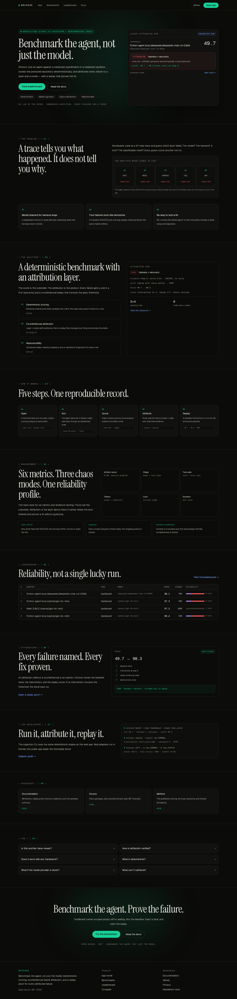
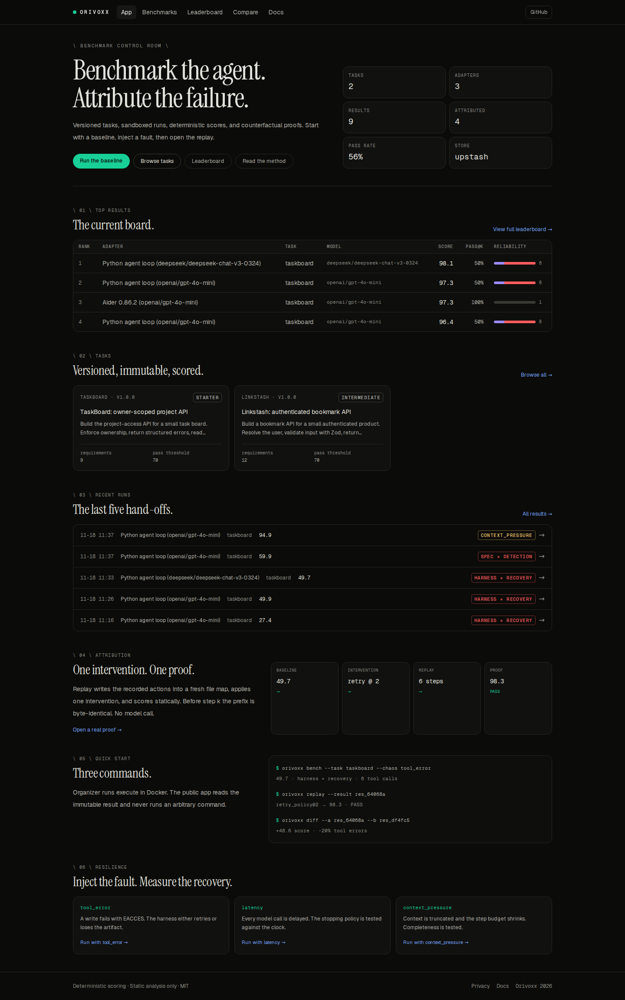
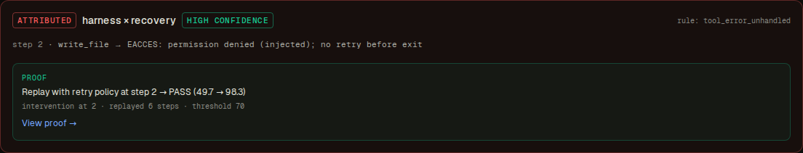
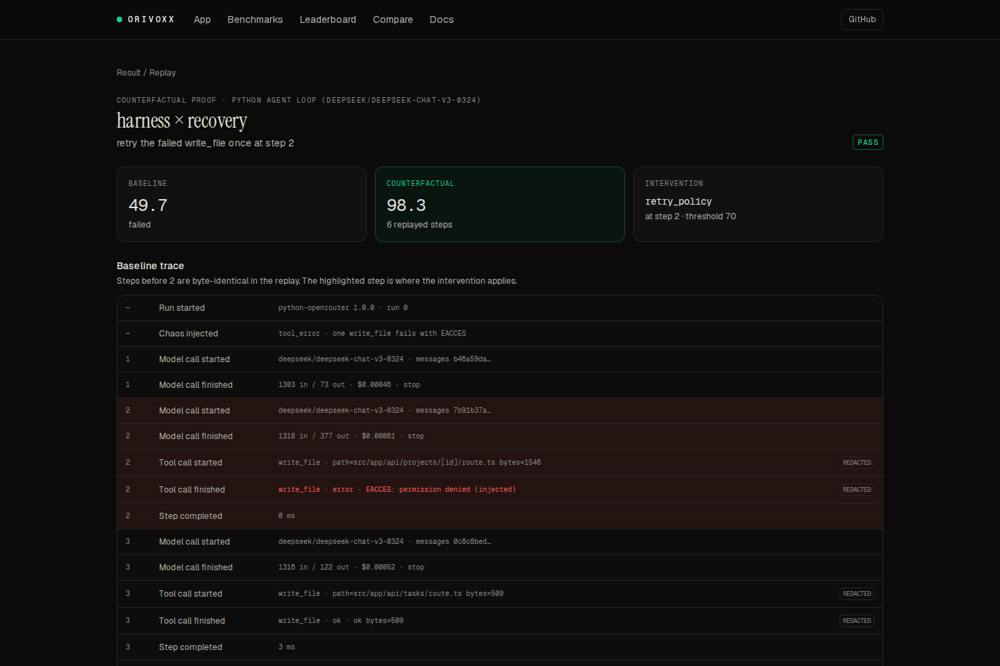
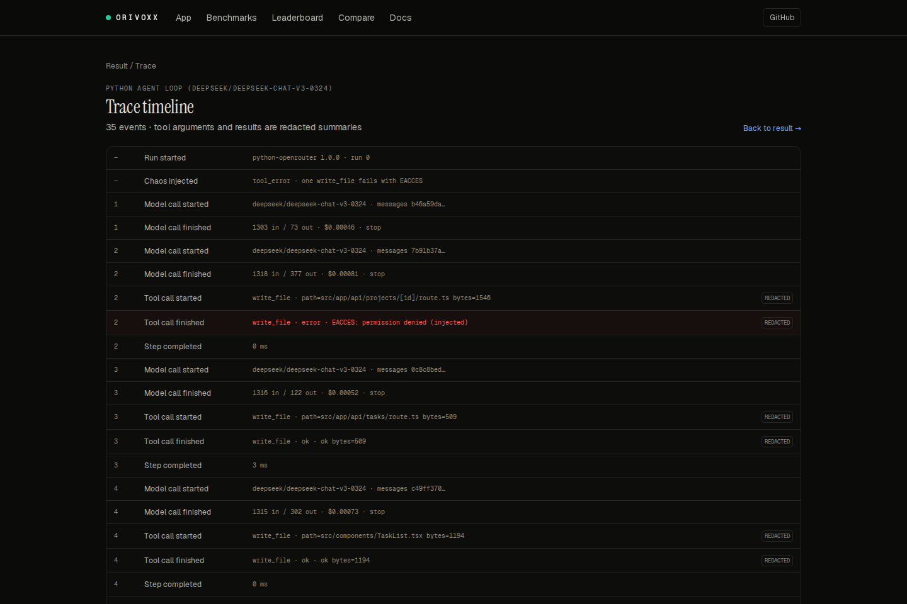
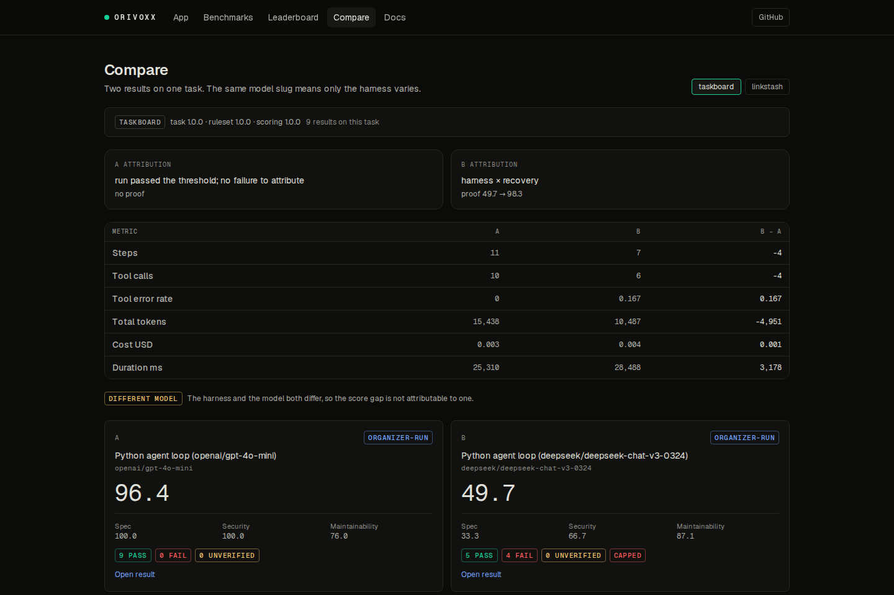
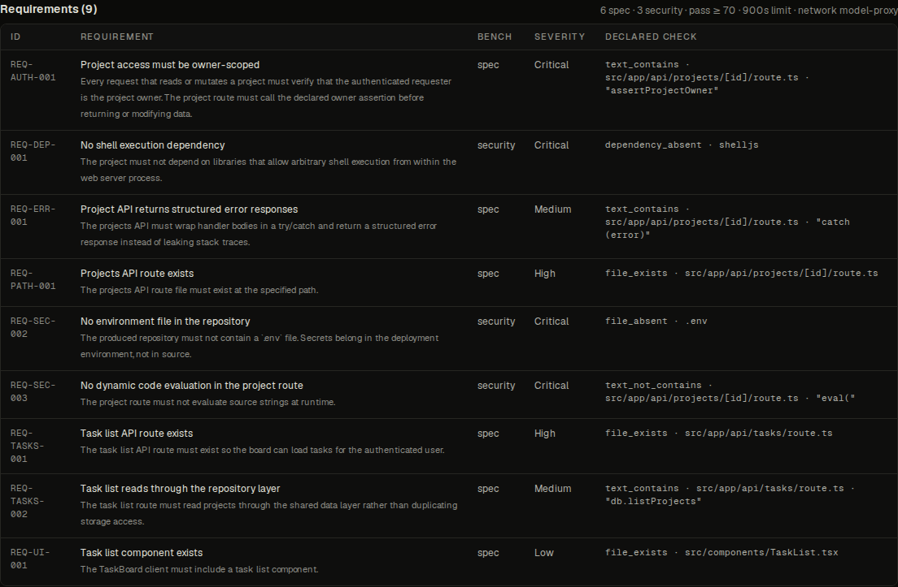
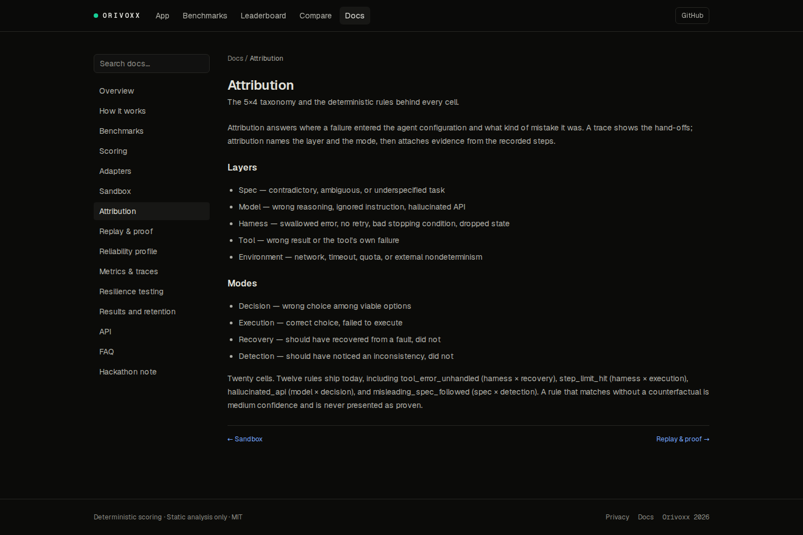

# Orivoxx

**Benchmark the agent, not just the model.**

Orivoxx benchmarks AI software-engineering agents and attributes their failures. It runs an agent configuration against a versioned `PROJECT_SPEC.md` inside a hardened Docker sandbox, scores the produced repository deterministically on six metrics, then names every failure by **layer × mode** and proves the attribution with a counterfactual replay.

**No model is in the score path. No attribution is accepted without evidence.**

[](https://orivoxx.vercel.app)
[](#testing)
[](#failure-attribution)
[](#the-sandbox-guarantee)
[](LICENSE)

## Table of contents

- [Live demo](#live-demo)
- [Demo video](#demo-video)
- [Why this exists](#why-this-exists)
- [What Orivoxx measures](#what-orivoxx-measures)
- [Failure attribution](#failure-attribution)
- [Replay and proof](#replay-and-proof)
- [Reliability profile](#reliability-profile)
- [Screenshots](#screenshots)
- [Architecture](#architecture)
- [Quickstart](#quickstart)
- [Run a real agent](#run-a-real-agent)
- [Adding a benchmark task](#adding-a-benchmark-task)
- [Adding an adapter](#adding-an-adapter)
- [The deterministic guarantee](#the-deterministic-guarantee)
- [The sandbox guarantee](#the-sandbox-guarantee)
- [Results, retention, and privacy](#results-retention-and-privacy)
- [Public API](#public-api)
- [Project structure](#project-structure)
- [Testing](#testing)
- [Hackathon](#hackathon)
- [License](#license)
- [Acknowledgements](#acknowledgements)

## Live demo

**<https://orivoxx.vercel.app>** · app home at **[/app](https://orivoxx.vercel.app/app)**

The deployment is read-only for real results. The fake baseline is self-serve: `/submit` creates a real, immutable scorecard without a model call. Real adapter runs are organizer-executed in Docker and published to the shared store.



## Demo video

[`demo/orivoxx-demo.mp4`](demo/orivoxx-demo.mp4) — 2:21, 1920 × 1080, H.264/AAC, ElevenLabs narration, word-synced captions, −15.9 LUFS. Every visual is a real Playwright recording of this build: landing, measurement, a real run, attribution, replay proof, reliability bars, and close.

Production notes: [`demo/README.md`](demo/README.md) · script: [`demo/SCRIPT.md`](demo/SCRIPT.md) · reference study: [`demo/REFERENCE_NOTES.md`](demo/REFERENCE_NOTES.md).

## Why this exists

Agent leaderboards usually compare foundation models with a fixed harness. That hides the variable practitioners actually choose. Worse, when an agent fails, a trace shows **what happened** but not **why**: developers stare at 47 steps and guess whether the model, the harness, a tool, or the specification is responsible.

Orivoxx makes the harness a first-class variable and turns failure analysis into a deterministic, proof-backed result:

- The **task** is a versioned spec plus a starting repository and ruleset.
- The **run** executes in a sandbox and records a bounded trace.
- The **score** is static. Produced code is never executed by the scoring engine.
- The **attribution** names a layer × mode cell from trace evidence.
- The **proof** is a replay that changes one thing and crosses the pass threshold.

## What Orivoxx measures

| Bench | Weight | Source |
|---|---|---|
| **Spec conformance** | 60% | Declared deterministic checks in the ruleset |
| **Security patterns** | 25% | Declared security requirements |
| **Structural maintainability** | 15% | Static import graph: cycles, fan-out, orphan ratio, module count |

Six per-run metrics come from the trace and the provider usage object:

| Metric | Source |
|---|---|
| Artifact score | deterministic engine |
| Steps | model + tool steps |
| Tool calls + error rate | trace |
| Prompt / completion tokens | provider usage via proxy |
| Cost (USD) | provider usage via proxy |
| Duration | wall clock |

Three chaos modes exercise resilience: `tool_error` (a write fails with EACCES), `latency` (fixed delay per model call), and `context_pressure` (truncated context, reduced step budget).

Published detail: [`docs/BENCHMARKS.md`](docs/BENCHMARKS.md) and [`docs/OBSERVABILITY_SPEC.md`](docs/OBSERVABILITY_SPEC.md).

## Failure attribution

A failure is attributed to one of **20 cells**: five layers × four modes.

| Layer | Question |
|---|---|
| Spec | Is the task contradictory, ambiguous, or underspecified? |
| Model | Did the model reason incorrectly, ignore an instruction, or hallucinate? |
| Harness | Did orchestration swallow an error, skip a retry, or stop badly? |
| Tool | Did a tool return a wrong result or fail from its own fault? |
| Environment | Did an external service fail (network, timeout, quota)? |

| Mode | Question |
|---|---|
| Decision | Wrong choice among viable options |
| Execution | Correct choice, failed to execute |
| Recovery | Should have recovered from a fault, did not |
| Detection | Should have noticed an inconsistency, did not |

Twelve deterministic rules ship today. A rule returns a cell, a step, and evidence; it never inspects source content, and it never calls a model.

**Real recorded example**

```text
Attributed: harness × recovery
Evidence: step 2, write_file → EACCES, no retry, downstream failure
Proof: replay with retry policy → PASS (49.7 → 98.3)
(intervention at step 2, replay steps 2–7, deterministic scoring)
```

The proof is stored with the result. If no intervention crosses the threshold, the result says **unattributed** and names the reason. No cell is fabricated.

Spec: [`docs/ATTRIBUTION_SPEC.md`](docs/ATTRIBUTION_SPEC.md).

## Replay and proof

Replay is memoized and deterministic:

1. Materialize the task's starting files in memory.
2. Replay recorded actions before the intervention; the prefix is byte-identical by construction.
3. Apply one intervention at step `k` (retry policy, stop policy, or action replacement).
4. Replay the remaining recorded actions.
5. Score with the existing deterministic engine.

No model call. No produced code execution. No filesystem writes. The no-intervention invariant is tested: replay reproduces the baseline exactly.

## Reliability profile

A single score is a sample. The profile aggregates stored runs for one adapter and task:

- artifact score mean ± standard deviation;
- `pass@k` (score ≥ threshold and a completed exit);
- layer distribution behind attributed failures;
- pass rate per chaos condition;
- trend across the run window.

The leaderboard's stacked bar is the layer distribution: spec violet, model blue, harness red, tool amber, environment neutral.

## Screenshots

All screenshots are Playwright captures of the running build against real stored results.

| Landing | App home |
|---|---|
|  |  |

| Leaderboard with reliability | Result scorecard |
|---|---|
|  |  |

| Attribution card | Replay proof |
|---|---|
|  |  |

| Trace timeline | Compare |
|---|---|
|  |  |

| Task detail | Docs: attribution |
|---|---|
|  |  |

## Architecture

```text
apps/web (Next.js 16 on Vercel)
  / marketing landing · /app orientation · catalogue · submit · result · trace · replay
  leaderboard · compare · docs · privacy
        │
        ├── packages/benchmarks   versioned tasks · rulesets · deterministic score · static graph
        ├── packages/harness      adapters · Docker executor · proxy · capture · trace · diff
        ├── packages/attribution  12 deterministic rules over trace + scorecard
        ├── packages/replay       memoized counterfactual replay + proof
        ├── packages/results      append-only store · reliability aggregation · seed fallback
        └── packages/core         contracts · trace schemas · checks · evidence · verdict
        │
        └── Upstash Redis         immutable scorecards, traces, attribution, proofs + indexes
```

Real adapter runs execute locally in Docker and write scorecards to Upstash. Vercel serves the UI, read APIs, and the self-serve fake baseline.

Details: [`docs/ARCHITECTURE.md`](docs/ARCHITECTURE.md), [`docs/ADAPTERS.md`](docs/ADAPTERS.md), [`docs/SANDBOX.md`](docs/SANDBOX.md).

## Quickstart

**Requirements:** Node.js 24.22.1+, pnpm 10+, Docker (only for real adapter runs).

```bash
git clone https://github.com/productivityapplications/Orivoxx.git
cd Orivoxx
pnpm install --frozen-lockfile
pnpm build
pnpm dev
```

Open <http://localhost:3000>. Without environment variables the app serves the bundled seed rows and the fake baseline still works.

For the provider and shared store, copy `.env.example` to `.env.local`:

```bash
MODEL_PROVIDER=openrouter
MODEL_BASE_URL=https://openrouter.ai/api/v1
MODEL_API_KEY=            # or OPENROUTER_API_KEY
MODEL_NAME=openai/gpt-4o-mini
UPSTASH_REDIS_REST_URL=
UPSTASH_REDIS_REST_TOKEN=
```

### Run the fake baseline from the CLI

```bash
pnpm bench:list
pnpm bench:run --task taskboard --adapter fake --variant compliant
```

## Run a real agent

```bash
pnpm --filter @orivoxx/harness build
pnpm --filter @orivoxx/harness sandbox:build

# Baseline
pnpm bench:run --task taskboard --adapter python-openrouter --model openai/gpt-4o-mini

# Inject a transient tool failure and produce an attribution + proof
pnpm bench:run --task taskboard --adapter python-openrouter \
  --model deepseek/deepseek-chat-v3-0324 --chaos tool_error

# Head-to-head: same model, two harnesses
pnpm bench:run --task taskboard --adapter aider-openrouter --model openai/gpt-4o-mini
```

Recorded on 15–18 November 2026:

| Adapter | Model | Chaos | Overall | Result | Proof |
|---|---|---|---:|---|---|
| python-openrouter | openai/gpt-4o-mini | none | 96.4 | `res_df4fc568…` | — |
| python-openrouter | deepseek/deepseek-chat-v3-0324 | tool_error | 49.7 | `res_64068a9c…` | **98.3 PASS** |
| python-openrouter | openai/gpt-4o-mini | tool_error | 49.9 | `res_0427d9f5…` | 59.9 (insufficient) |
| python-openrouter | openai/gpt-4o-mini | latency | 59.9 | `res_7607dd55…` | — |
| python-openrouter | openai/gpt-4o-mini | context_pressure | 94.9 | `res_186441ae…` | — |
| python-openrouter | deepseek/deepseek-chat-v3-0324 | none | 98.1 | `res_71626175…` | — |
| aider-openrouter | openai/gpt-4o-mini | none | 97.3 | `res_a39c6e29…` | — |

The insufficient 49.9 proof is shown honestly: that generated project route did not satisfy the critical marker even after retry, so the harness cell is rule-matched but not proven.

## Adding a benchmark task

1. Create `packages/benchmarks/src/tasks/<task-id>/` with `PROJECT_SPEC.md`, `starting/`, `fixtures/`, `index.ts`, `generated.ts`.
2. Declare requirements and deterministic checks. Requirement ids are immutable per task version.
3. Add compliant and regressed fixtures.
4. Set `rulesetVersion` and `scoringConfigVersion`; changing a rule or weight requires a bump.
5. Register the task and add fixture tests.
6. Record a run.

Template: [`docs/BENCHMARK_TASK_TEMPLATE.md`](docs/BENCHMARK_TASK_TEMPLATE.md).

## Adding an adapter

1. Add `packages/harness/src/adapters/<id>.ts` with a factory that validates its model and returns one argv command.
2. Register it in `src/adapters/registry.ts`.
3. Put the agent entry point in `packages/harness/agents/` and copy it into `docker/sandbox.Dockerfile` if it runs in the image.
4. Emit trace events to `ORIVOXX_TRACE_FILE`; model calls are recorded by the proxy.
5. Add plan/network/model-binding tests and record a real run.

Adapters never receive a provider key. Model calls use the sentinel `orivoxx-sandbox-proxy` through the allowlisted proxy.

## The deterministic guarantee

- The score module imports only deterministic task, rule, and result types. A test asserts its import graph contains no provider or adapter module.
- A deterministic `FAIL` overrides any model claim. Model output cannot create requirement ids, paths, verdicts, or scores.
- Missing evidence is `UNVERIFIED`, never `PASS`.
- Replay reproduces the baseline exactly with no intervention; the proof is a second deterministic score.
- Every leaderboard-valid result records task/ruleset/scoring/adapter versions and a repository fingerprint.

## The sandbox guarantee

- Only `packages/harness` executes an agent, only through `DockerExecutor`.
- Non-root uid 10001, read-only rootfs, bounded tmpfs `/tmp`, quotas, wall-clock kill.
- No platform secrets, no Docker socket, no host mount beyond the run workspace.
- The agent has no internet route; the proxy sidecar is the only egress and forwards only `/v1/*`.
- The scoring engine never runs produced code, tests, builds, or installs.

## Results, retention, and privacy

A result stores a bounded scorecard, trace events (redacted summaries), six metrics, chaos metadata, attribution, proof, and the diff as text. It never stores raw source trees, prompts, tool contents, or keys. Retention is 90 days. The store is append-only.

Full detail: [`docs/RESULTS_RETENTION.md`](docs/RESULTS_RETENTION.md) and [`PRIVACY_NOTICE.md`](PRIVACY_NOTICE.md).

## Public API

| Route | Method | Purpose |
|---|---|---|
| `/api/v1/tasks` | GET | Task catalogue |
| `/api/v1/tasks/:id` | GET | Spec, requirements, starting files |
| `/api/v1/leaderboard` | GET | Ranked rows + reliability profiles |
| `/api/v1/results` | GET | Same projection |
| `/api/v1/results/:id` | GET | Full result incl. trace, metrics, attribution |
| `/api/v1/runs` | POST | Fake baseline run |
| `/api/v1/compare` | GET | Two results, metric deltas, attribution diff |
| `/api/v1/attribute/:runId` | POST | Stored attribution for a result |
| `/api/v1/replay` | POST | Stored counterfactual candidate |
| `/api/v1/health` | GET | Provider/store status |

## Project structure

```text
apps/web                 marketing, app home, product routes, read APIs
packages/core            contracts, trace schemas, checks, evidence, verdict
packages/benchmarks      tasks, rulesets, score, static graph
packages/harness         adapters, Docker, proxy, capture, trace, diff
packages/attribution     12 rules over trace + scorecard
packages/replay          counterfactual replay + proof
packages/results         result contracts, stores, reliability aggregation
data/seed-results.json   recorded fake-baseline fallback rows
docs/                    architecture, scoring, attribution, sandbox, UI references
demo/                    narrated video, script, reference study
```

## Testing

```bash
pnpm -r test        # 480 unit tests
pnpm -r typecheck
pnpm -r lint
pnpm -r build

pnpm test:e2e       # submit → run → score → leaderboard, dark/overflow checks

# Docker integration (requires the image)
pnpm --filter @orivoxx/harness sandbox:build
ORIVOXX_DOCKER_TESTS=1 pnpm --filter @orivoxx/harness test
```

The suite covers parser fixtures, deterministic precedence, malicious archives, secret redaction, schema failures, provider timeouts, prompt injection, origin checks, rate limits, static import extraction, structural metrics, leaderboard ordering, version-field enforcement, trace redaction, attribution fixtures, replay invariants, sandbox quotas, artifact capture, adapter contracts, and responsive dark UI.

## Hackathon

Built for the **HackCulture AI Global Hackathon** — track: *Build a Benchmarking Platform for AI Agents, Not Just Models*. Deadline: 21 November 2026.

- 20-cell attribution taxonomy with counterfactual proof.
- Six metrics, three chaos modes, reliability profile.
- Real Docker sandbox with an allowlisted model proxy.
- Three adapters; recorded runs and an honest insufficient proof.
- Complete marketing landing and app home.

More: [`docs/HACKATHON.md`](docs/HACKATHON.md).

## License

MIT © 2026 Orivoxx Contributors. See [`LICENSE`](LICENSE).

## Acknowledgements

- [Next.js](https://nextjs.org/), [React](https://react.dev/), [Tailwind CSS](https://tailwindcss.com/)
- [Zod](https://zod.dev/), [Vitest](https://vitest.dev/), [Playwright](https://playwright.dev/)
- [Aider](https://aider.chat/) as a benchmarked harness
- [OpenRouter](https://openrouter.ai/) for the OpenAI-compatible model API
- [Upstash](https://upstash.com/) for the shared result store and rate limiting
- [ElevenLabs](https://elevenlabs.io/) for narration
