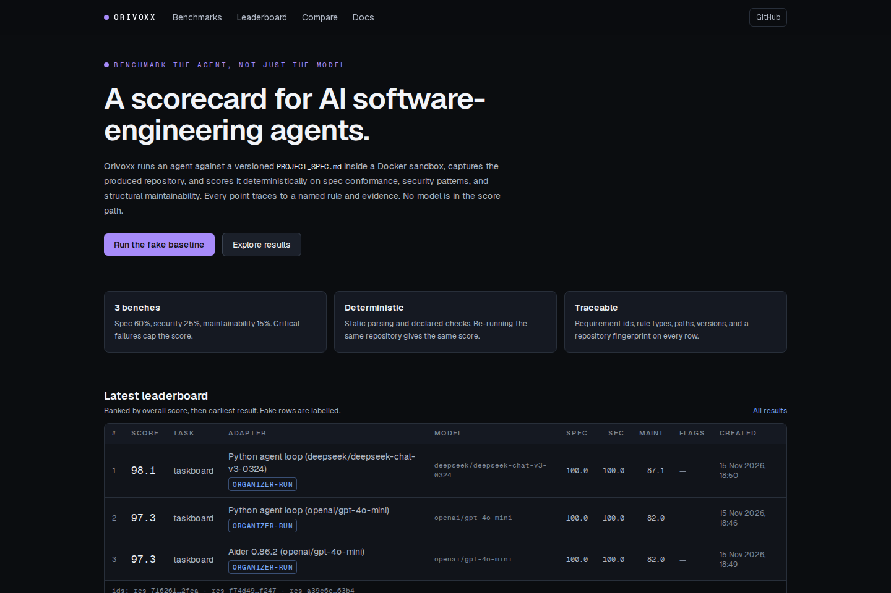
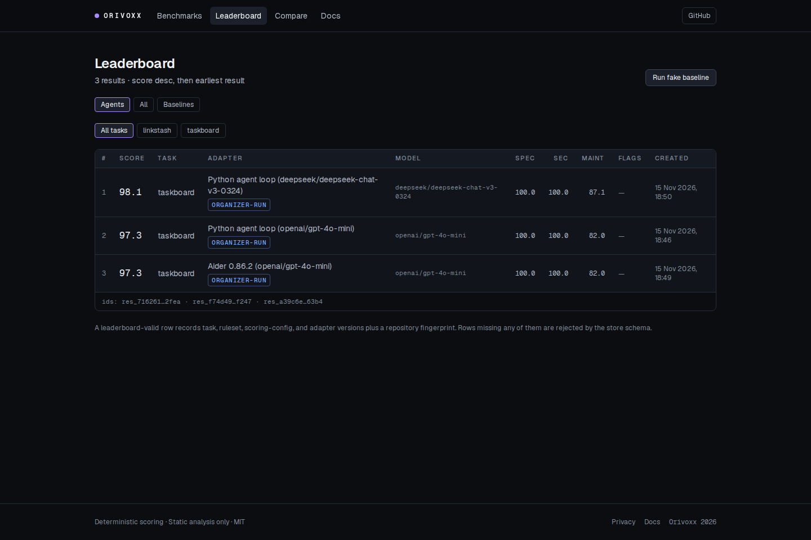
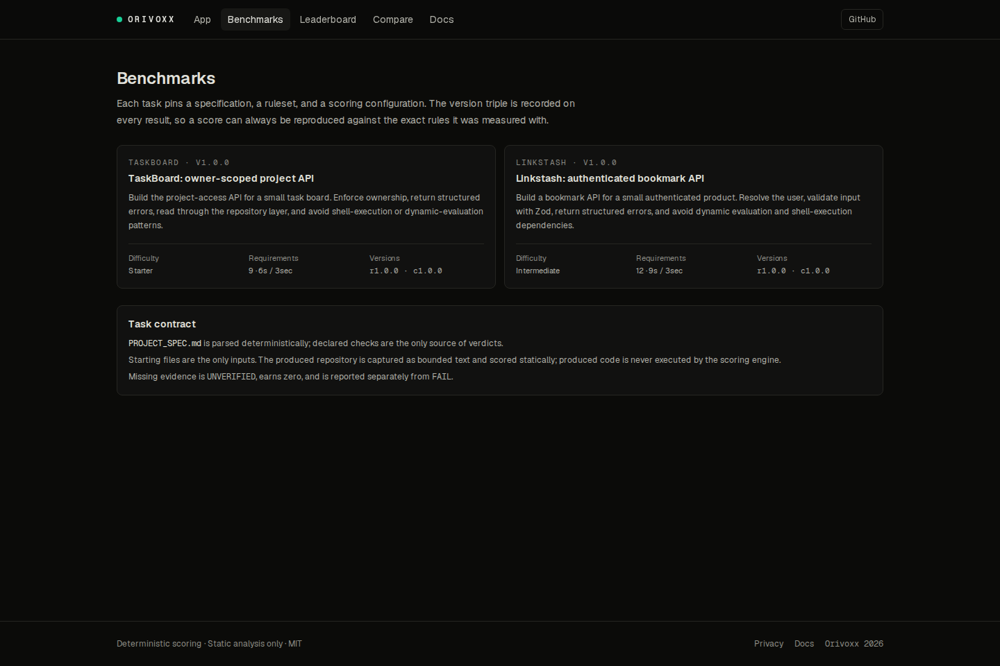
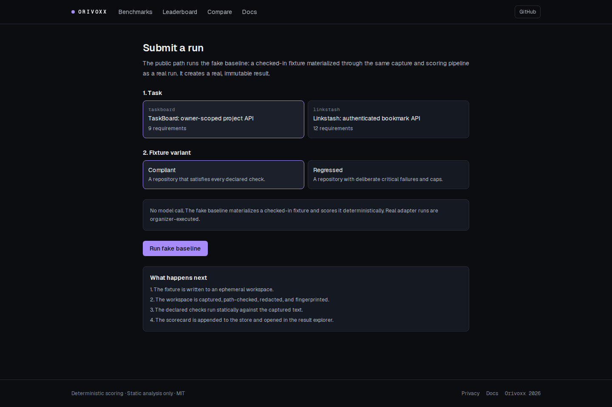
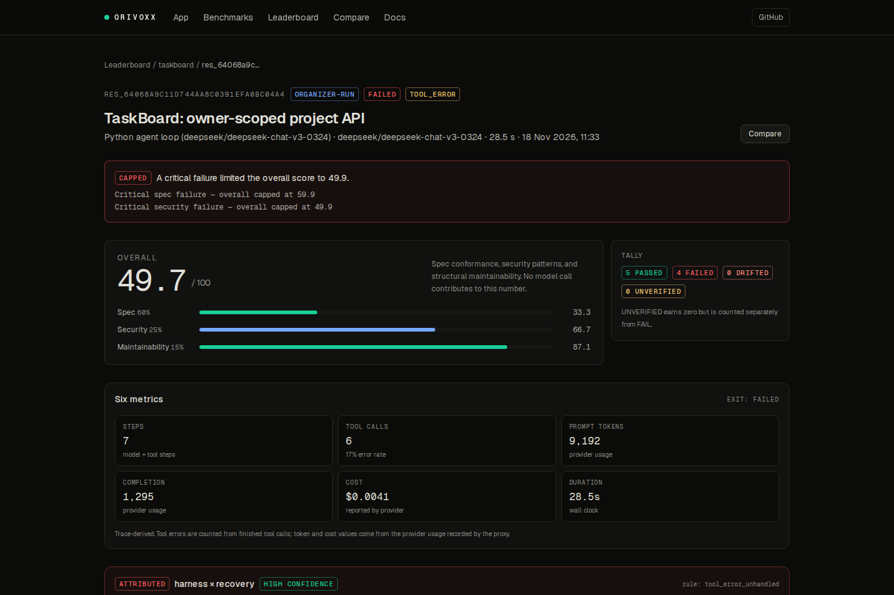
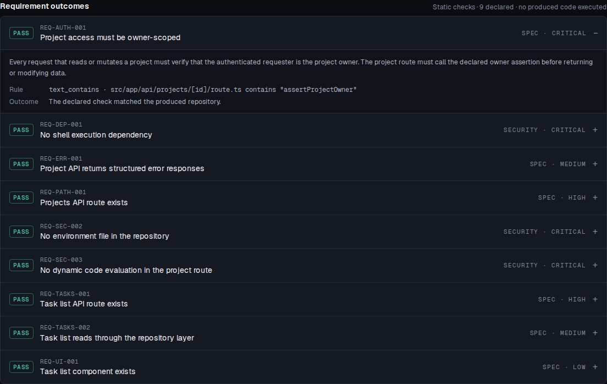
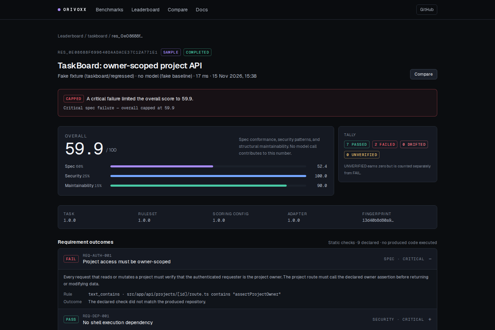

# Orivoxx

**Benchmark the agent, not just the model.**

Orivoxx is a benchmarking platform for AI software-engineering agents. It runs an agent configuration — model, harness, tools, orchestration, and stopping conditions — against a versioned `PROJECT_SPEC.md` inside an isolated Docker sandbox, captures the produced repository, and scores it deterministically on spec conformance, security patterns, and structural maintainability.

Every point traces to a named rule and evidence. **No model is in the score path.**



[](#testing)
[](#the-deterministic-guarantee)
[](#the-sandbox-guarantee)
[](https://orivoxx.vercel.app)
[](LICENSE)

## Table of contents

- [Why this exists](#why-this-exists)
- [What it measures](#what-it-measures)
- [Demo video](#demo-video)
- [Screenshots](#screenshots)
- [Architecture](#architecture)
- [Live demo](#live-demo)
- [Quickstart](#quickstart)
- [Run a real agent](#run-a-real-agent)
- [Adding a benchmark task](#adding-a-benchmark-task)
- [Adding an adapter](#adding-an-adapter)
- [The deterministic guarantee](#the-deterministic-guarantee)
- [The sandbox guarantee](#the-sandbox-guarantee)
- [Results, retention, and privacy](#results-retention-and-privacy)
- [Public API](#public-api)
- [Project structure](#project-structure)
- [Testing](#testing)
- [Hackathon](#hackathon)
- [License](#license)
- [Acknowledgements](#acknowledgements)

## Why this exists

Agent benchmarks usually compare foundation models with a fixed harness. That hides the variable that matters in practice: **the agent configuration**. A different tool loop, prompt strategy, file-edit format, or stopping condition changes the result even when the model is identical.

Orivoxx holds the task and model constant where you want them constant, and measures the produced repository with a published rubric:

- The **task** is a versioned spec plus a starting repository and a deterministic ruleset.
- The **harness** is an adapter that runs inside a hardened Docker sandbox.
- The **score** is computed statically from the captured text. Produced code is never executed by the scoring engine.
- The **record** is immutable and carries every version needed to reproduce it.

Two harnesses on one model can score differently. That difference is the product.

## What it measures

| Bench | Weight | Source | Example checks |
|---|---|---|---|
| **Spec conformance** | 60% | Declared deterministic checks in the task ruleset | File exists, text marker present, dependency absent |
| **Security patterns** | 25% | Declared security requirements | No `.env`, no dynamic evaluation, no shell-execution dependency |
| **Structural maintainability** | 15% | Static import graph | Dependency cycles, max fan-out, orphan ratio, module count |

Scoring is severity-weighted: critical 8, high 4, medium 2, low 1. `PASS` earns full weight; `FAIL` and `DRIFT` earn zero; `UNVERIFIED` earns zero but is reported separately. A critical spec failure caps the overall score at **59.9**; a critical security failure caps it at **49.9**. Caps are stored and shown in the UI, never hidden.

Published detail: [`docs/BENCHMARKS.md`](docs/BENCHMARKS.md).

## Demo video

[`demo/orivoxx-demo.mp4`](demo/orivoxx-demo.mp4) — 2:38, 1920 × 1080, H.264/AAC, narrated and captioned. Every visual is a real screen recording of this build: landing, versioned task, leaderboard, a 97.3 result with requirement evidence, compare, and a self-serve fake run that lands on a capped 59.9 result.

Pipeline and checks: [`demo/README.md`](demo/README.md) · script: [`demo/SCRIPT.md`](demo/SCRIPT.md).

> Narration provider note: ElevenLabs was attempted first; the configured library voice requires a paid plan and the remaining free character quota covered only three scenes. The shipped cut uses a local Piper voice for consistency. Recorded in `BUILD_LOG.md`.

## Screenshots

All screenshots are captured by Playwright from the running build against real stored results.

| Leaderboard | Task catalogue |
|---|---|
|  |  |

| Task detail | Submit the fake baseline |
|---|---|
|  |  |

| Result scorecard | Requirement evidence |
|---|---|
|  |  |

| Cap banner | Compare two harnesses |
|---|---|
|  |  |

## Architecture

```text
apps/web (Next.js 16 on Vercel)
  landing · task catalogue · submit · result explorer · leaderboard · compare · docs
  /api/v1/tasks · /api/v1/runs · /api/v1/results · /api/v1/leaderboard
        │
        ├── packages/benchmarks   versioned tasks · rulesets · deterministic score · static graph
        ├── packages/harness      adapters · Docker executor · allowlisted proxy · capture · diff
        ├── packages/results      append-only store · Upstash · local · seed fallback
        └── packages/core         spec parser · deterministic checks · evidence · verdict
        │
        └── Upstash Redis         immutable scorecards + ranked indexes
```

Real adapter runs execute locally in Docker and write scorecards to Upstash. Vercel serves the UI, read APIs, and the self-serve fake baseline. The scoring engine receives normalized files, never an execution handle.

Details: [`docs/ARCHITECTURE.md`](docs/ARCHITECTURE.md), [`docs/ADAPTERS.md`](docs/ADAPTERS.md), [`docs/SANDBOX.md`](docs/SANDBOX.md).

## Live demo

**<https://orivoxx.vercel.app>**

The deployment is read-only for real results. The fake baseline is self-serve: `/submit` creates a real, immutable scorecard without a model call. Real adapter runs are organizer-executed in Docker, then published to the shared store.

## Quickstart

**Requirements:** Node.js 24.22.1+, pnpm 10+, Docker (only for real adapter runs).

```bash
git clone https://github.com/productivityapplications/Orivoxx.git
cd orivoxx
pnpm install --frozen-lockfile
pnpm build
pnpm dev
```

Open <http://localhost:3000>. Without any environment variables the app serves the bundled seed rows and the fake baseline still works.

To configure the model provider and the shared store, copy `.env.example` to `.env.local` and fill in:

```bash
MODEL_PROVIDER=openrouter
MODEL_BASE_URL=https://openrouter.ai/api/v1
MODEL_API_KEY=            # or OPENROUTER_API_KEY
MODEL_NAME=openai/gpt-4o-mini
UPSTASH_REDIS_REST_URL=
UPSTASH_REDIS_REST_TOKEN=
```

Only server-side variables are used. No secret is prefixed with `NEXT_PUBLIC_`.

### Run the fake baseline from the CLI

```bash
pnpm bench:list
pnpm bench:run --task taskboard --adapter fake --variant compliant
```

The fake baseline materializes a checked-in fixture, captures it, scores it deterministically, and appends the result. It never calls a model.

## Run a real agent

```bash
# Build the sandbox image once (Node 24, Python 3.12, Aider 0.86.2)
pnpm --filter @orivoxx/harness build
pnpm --filter @orivoxx/harness sandbox:build

# Head-to-head: same model, two harnesses
pnpm bench:run --task taskboard --adapter python-openrouter --model openai/gpt-4o-mini
pnpm bench:run --task taskboard --adapter aider-openrouter  --model openai/gpt-4o-mini

# Same harness, different model
pnpm bench:run --task taskboard --adapter python-openrouter --model deepseek/deepseek-chat-v3-0324
```

Recorded on 15 November 2026:

| Adapter | Model | Overall | Spec / Sec / Maint | Caps |
|---|---|---|---|---|
| `python-openrouter` | `openai/gpt-4o-mini` | **97.3** | 100 / 100 / 82.0 | none |
| `aider-openrouter` | `openai/gpt-4o-mini` | **97.3** | 100 / 100 / 82.0 | none |
| `python-openrouter` | `deepseek/deepseek-chat-v3-0324` | **98.1** | 100 / 100 / 87.1 | none |

The first two rows are the head-to-head pair: one model slug, two harnesses. Model identity is recorded per run; no slug is a product invariant.

## Adding a benchmark task

1. Create `packages/benchmarks/src/tasks/<task-id>/` with `PROJECT_SPEC.md`, `starting/`, `fixtures/`, `index.ts`, and `generated.ts`.
2. Declare requirements and deterministic checks in the task builder. Requirement ids are immutable per task version.
3. Add a compliant fixture and a regressed fixture. Fixtures are synthetic and publicly redistributable.
4. Set `rulesetVersion` and `scoringConfigVersion`; changing any rule or weight requires a version bump.
5. Register the task in `packages/benchmarks/src/tasks/index.ts`.
6. Add fixture tests: the compliant fixture must pass every check; the regressed fixture must fail the declared criticals.
7. Record a run: `pnpm bench:run --task <id> --adapter fake --variant compliant`.

Authoring template: [`docs/BENCHMARK_TASK_TEMPLATE.md`](docs/BENCHMARK_TASK_TEMPLATE.md).

## Adding an adapter

1. Add `packages/harness/src/adapters/<id>.ts` with a factory that validates its model and returns one argv command.
2. Register it in `src/adapters/registry.ts`.
3. Put the agent entry point in `packages/harness/agents/` and copy it into `docker/sandbox.Dockerfile` if it runs in the image.
4. Add unit tests for plan shape, network requirement, model binding, and secret handling.
5. Document it in [`docs/ADAPTERS.md`](docs/ADAPTERS.md) and record a real run.

Adapters never receive a provider key. Model calls go through the allowlisted proxy with the sentinel `orivoxx-sandbox-proxy`.

## The deterministic guarantee

- The score module imports only deterministic task, rule, and result types. A test asserts that its import graph contains no provider or adapter module.
- A deterministic `FAIL` overrides any model claim. Model output cannot create requirement ids, source paths, line references, check rules, verdicts, or scores.
- Missing evidence is `UNVERIFIED`, never `PASS`.
- Re-running the same captured repository with the same versions produces the same score.
- Every leaderboard-valid result records `taskVersion`, `rulesetVersion`, `scoringConfigVersion`, `adapterVersion`, and `repositoryFingerprint`. A row missing any of them is rejected by the schema.

## The sandbox guarantee

- Only `packages/harness` executes an agent, and only through `DockerExecutor`.
- Non-root uid 10001, read-only root filesystem, bounded tmpfs `/tmp`, CPU/memory/PID/file-descriptor quotas, and a wall-clock kill.
- No platform secrets, no Docker socket, no host filesystem mount beyond the run workspace.
- The agent container has no internet route. The proxy sidecar is the only egress and forwards only `/v1/*` with bounded bodies.
- The scoring engine never runs produced code, tests, builds, or package installs.

## Results, retention, and privacy

A stored result contains a bounded scorecard, requirement outcomes, cap reasons, structural metrics, run metadata, adapter/model identity, version fields, and the produced-code diff as bounded text. It never contains full source trees, archives, prompts, raw model responses, or keys. Retention is 90 days. The store interface is append-only.

Full detail: [`docs/RESULTS_RETENTION.md`](docs/RESULTS_RETENTION.md) and [`PRIVACY_NOTICE.md`](PRIVACY_NOTICE.md).

## Public API

| Route | Method | Purpose |
|---|---|---|
| `/api/v1/tasks` | GET | Task catalogue with version fields |
| `/api/v1/tasks/:id` | GET | Spec, requirements, starting files |
| `/api/v1/leaderboard` | GET | Ranked rows (`taskId`, `kind`, `limit`) |
| `/api/v1/results` | GET | Same projection as the leaderboard |
| `/api/v1/results/:id` | GET | Full stored result |
| `/api/v1/runs` | POST | Fake baseline run (`taskId`, `variant`) |
| `/api/v1/health` | GET | Provider and store status, no secrets |

Mutating routes require a same-origin request, a JSON body under 4 KiB, and shared rate limiting in production. Every response is `cache-control: no-store`.

## Project structure

```text
apps/web                 Next.js UI, read APIs, fake run endpoint
packages/core            spec parser, deterministic checks, evidence, verdict
packages/benchmarks      task registry, rulesets, score, static import graph
packages/harness         adapters, Docker sandbox, proxy, capture, diff, CLI
packages/results         result contracts, local/Upstash stores, seed fallback
data/seed-results.json   recorded fake-baseline rows
docs/                    architecture, scoring, sandbox, adapters, retention, UI spec
demo/                    narrated demo video and production notes
```

## Testing

```bash
pnpm -r test        # 459 unit tests: core 217, benchmarks 63, results 53, harness 82, web 44
pnpm -r typecheck
pnpm -r lint
pnpm -r build

# End-to-end: submit -> run -> score -> leaderboard (throwaway local store)
pnpm test:e2e

# Docker sandbox integration suite (requires the image)
pnpm --filter @orivoxx/harness sandbox:build
ORIVOXX_DOCKER_TESTS=1 pnpm --filter @orivoxx/harness test
```

The suite covers parser fixtures, deterministic precedence, malicious archives, oversized payloads, secret redaction, schema failures, provider timeouts, prompt injection, explanation independence, origin checks, rate limits, static import extraction, structural metrics, leaderboard ordering, version-field enforcement, sandbox quotas, artifact capture, adapter contracts, and responsive dark UI.

## Hackathon

Built for the **HackCulture AI Global Hackathon** — track: *Build a Benchmarking Platform for AI Agents, Not Just Models*. Deadline: 21 November 2026.

- Deterministic scoring with no LLM in the score path.
- A real Docker sandbox with an allowlisted model proxy.
- Three adapters: fake baseline, Python agent loop, Aider.
- A public leaderboard and result explorer.
- Recorded real runs on one task, one model, two harnesses.

More: [`docs/HACKATHON.md`](docs/HACKATHON.md).

## License

MIT © 2026 Orivoxx Contributors. See [`LICENSE`](LICENSE).

## Acknowledgements

- [Next.js](https://nextjs.org/), [React](https://react.dev/), [Tailwind CSS](https://tailwindcss.com/)
- [Zod](https://zod.dev/), [Vitest](https://vitest.dev/), [Playwright](https://playwright.dev/)
- [Aider](https://aider.chat/) as a benchmarked harness
- [OpenRouter](https://openrouter.ai/) for the OpenAI-compatible model API
- [Upstash](https://upstash.com/) for the shared result store and rate limiting
- [fflate](https://github.com/101arrowz/fflate) for bounded ZIP parsing
