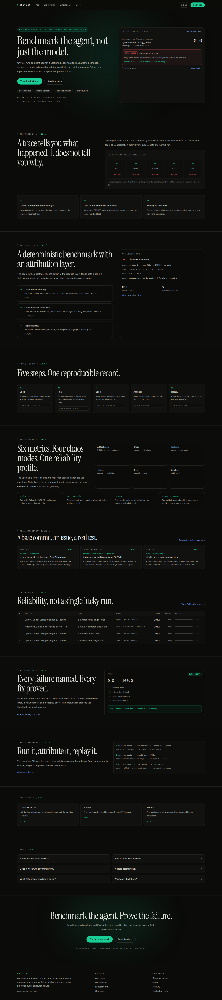
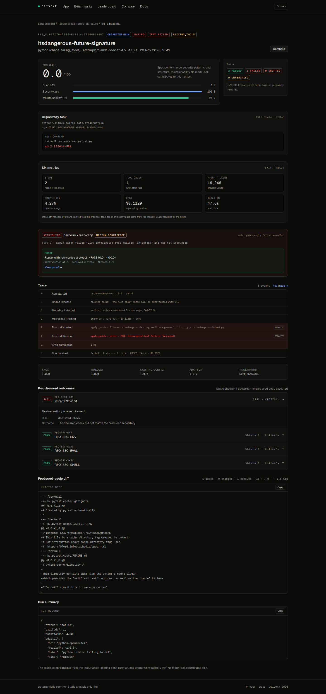
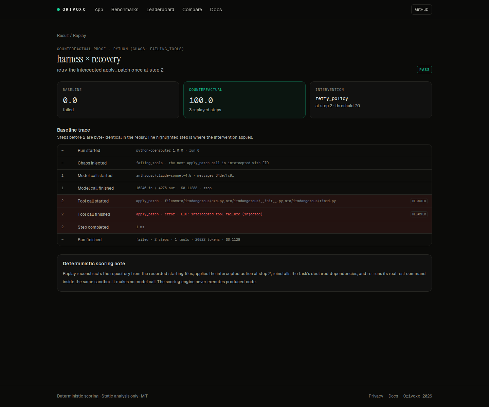
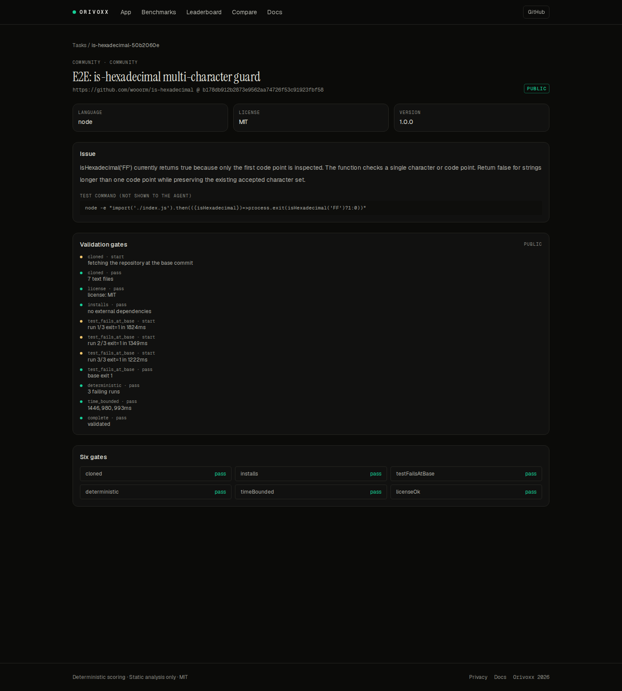
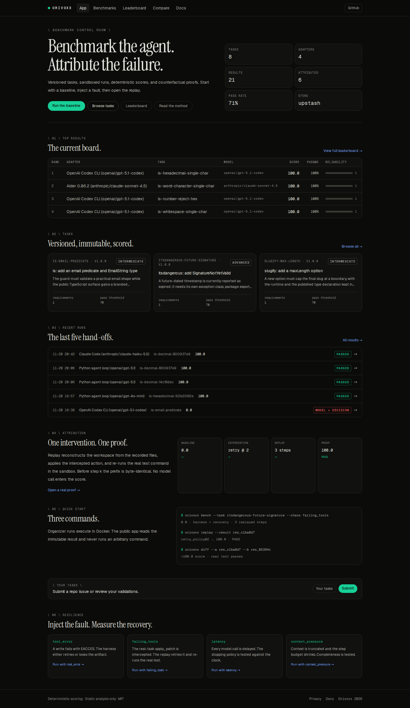
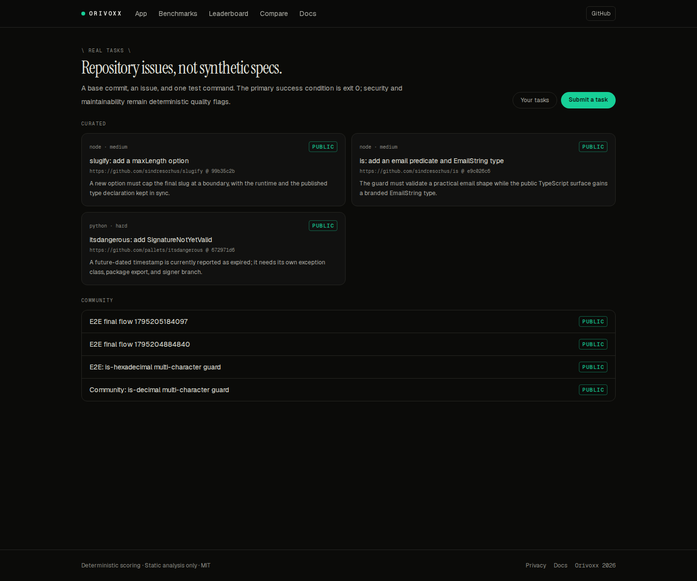
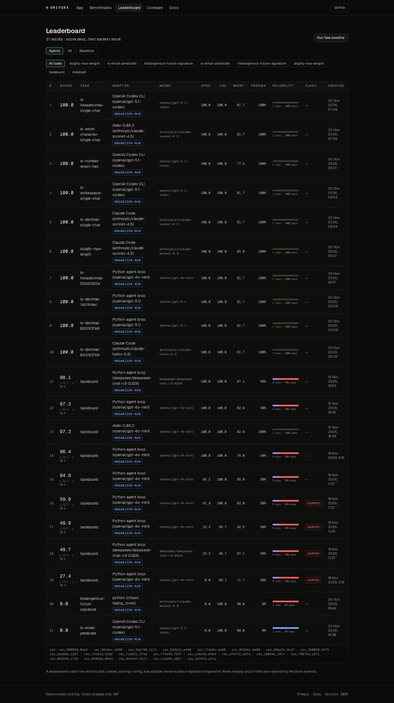
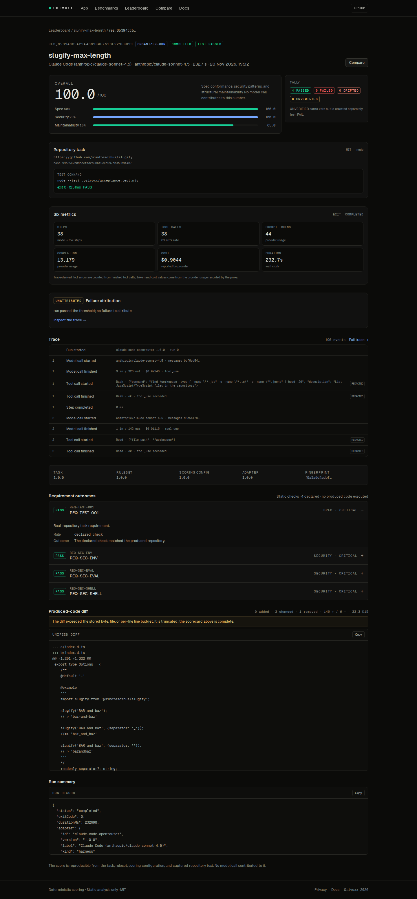

# Orivoxx

**Benchmark the agent, not just the model.**

[](https://nextjs.org/)
[](#quickstart)
[](#failure-attribution--replay)
[](LICENSE)



Orivoxx is a benchmarking and failure-attribution platform for AI software-engineering agents. It runs a complete agent configuration — model, harness, tools, orchestration, and stopping conditions — against real GitHub issues inside a hardened Docker sandbox. A deterministic engine scores the produced repository. When the run fails, Orivoxx names the failure by **layer × mode** and proves the diagnosis with a counterfactual replay that re-runs the real test command.

**No model is in the score path. No attribution is accepted without evidence.**

Live: <https://orivoxx.vercel.app>

## What is Orivoxx

Agent leaderboards usually compare foundation models behind one fixed harness. That hides the variable practitioners actually choose. Orivoxx treats the whole configuration as the subject: the same model can be run through Claude Code, Codex CLI, or Aider, and the result records the adapter, model, task version, ruleset, scoring config, and repository fingerprint.

A run produces:

- **Primary success** for real tasks: the repository's test command exits `0`.
- **Six metrics**: steps, tool calls, tool-error rate, tokens, cost, and duration.
- **Deterministic quality flags**: security patterns and structural maintainability, always published next to the test result.
- **A bounded trace** of model calls and tool calls, with arguments and results redacted.
- **An attribution** — one of 20 layer × mode cells, a rule id, step evidence, and (when a tool fault is intercepted) a replay proof.
- **A produced-code diff** as text, never the full repository or archive.

The scoring engine imports no provider, adapter, or network module; a test proves that invariant on the import graph.

## Brand Agents

| Agent | Runtime | OpenRouter route | Status |
|---|---|---|---|
| **Claude Code 2.1.329** | sandbox | `ANTHROPIC_BASE_URL` through the model proxy; sentinel auth token | Runs; solved `slugify-max-length` |
| **OpenAI Codex CLI 0.171.0** | sandbox | generated `config.toml`, Responses wire API through the proxy | Runs; passed the legacy tasks; failed the multi-file `is-email-predicate` |
| **Aider 0.86.2** | sandbox | OpenAI-compatible proxy, pinned in the image | Runs as the baseline |
| **GitHub Copilot CLI 1.0.114** | excluded | no OpenRouter base-url override; org policy denied access | Excluded |
| **Cursor** | excluded | not headless-routeable through OpenRouter | Excluded |
| **python-openrouter** | sandbox | custom Python loop through the proxy | Chaos and real-task proof harness |

The real provider key never enters the sandbox. Each CLI receives `orivoxx-sandbox-proxy`; the host-side sidecar injects the OpenRouter key and forwards only model calls plus an allowlisted package-manager CONNECT tunnel. GitHub Copilot and Cursor are deliberately not in the comparison.

## Real Tasks

The public comparison set uses real repositories, pinned base commits, a real issue, and one test command. The agent never sees the test command. A task declares its dependency install command; packages are fetched inside the sandbox through the allowlisted registry tunnel (`registry.npmjs.org`, `registry.yarnpkg.com`, `pypi.org`, `files.pythonhosted.org`). General egress stays closed.

| Task | Repository | License | What must change | Test |
|---|---|---|---|---|
| `slugify-max-length` | [`sindresorhus/slugify`](https://github.com/sindresorhus/slugify) | MIT | `index.js` + `index.d.ts` | `node --test .orivoxx/acceptance.test.mjs` |
| `is-email-predicate` | [`sindresorhus/is`](https://github.com/sindresorhus/is) | MIT | `source/index.ts` + `source/types.ts` | `node --experimental-transform-types --test .orivoxx/acceptance.test.mjs` |
| `itsdangerous-future-signature` | [`pallets/itsdangerous`](https://github.com/pallets/itsdangerous) | BSD-3-Clause | `exc.py` + `timed.py` + `__init__.py` | `python3 .orivoxx/run_pytest.py` |

All three passed the six validation gates: clone, install, test fails at base, deterministic ×3, time bounded, permissive license. Acceptance fixtures live under `.orivoxx/` and are rewritten after the agent exits, so an agent cannot weaken the test.

Recorded runs:

| Agent | Task | Test | Duration | Cost | Result |
|---|---|---|---:|---:|---|
| Claude Code (`anthropic/claude-sonnet-4.5`) | `slugify-max-length` | PASS | 232.7s | $0.9044 | [`res_85394cc5…`](https://orivoxx.vercel.app/results/res_85394cc5a29a4c89b0f7613e229ebd99) |
| Claude Code (`anthropic/claude-haiku-5.5`) | community `is-decimal-800937e9` | PASS | 11.8s | $0.0015 | [`res_74101d58…`](https://orivoxx.vercel.app/results/res_74101d582b994a66bc67936f79865502) |
| Python loop (`openai/gpt-5.1`) | community `is-decimal-800937e9` | PASS | 5.6s | $0.0068 | [`res_2ea69a6f…`](https://orivoxx.vercel.app/results/res_2ea69a6f1de543c481d945793129d3bf) |
| Codex CLI | `is-email-predicate` | FAIL | 492.7s | $0.7198 | [`res_e2767b1f…`](https://orivoxx.vercel.app/results/res_e2767b1f393b4adb8a0d74cdeeb0afca) |
| python (`chaos: failing_tools`) | `itsdangerous-future-signature` | FAIL | 47.8s | $0.1129 | [`res_c1ba8d7b…`](https://orivoxx.vercel.app/results/res_c1ba8d7b435e4ae6b514138458fab8b7) |

The Codex failure is a real model decision failure: it added `email: isEmail` but did not define the predicate, so the acceptance test failed. It is attributed to `model × decision` without a counterfactual. The chaos run is the proven attribution.

## Failure Attribution & Replay

A trace says *what* happened. Orivoxx answers *why*. Every attribution is a cell in a 5 × 4 taxonomy:

| Layer | Question |
|---|---|
| **Spec** | Was the requirement missing, contradictory, or ambiguous? |
| **Model** | Did the model reason incorrectly, ignore an instruction, or hallucinate? |
| **Harness** | Did orchestration swallow an error, skip a retry, or stop badly? |
| **Tool** | Did a tool return a wrong result or fail from its own fault? |
| **Environment** | Did an external service fail (network, timeout, quota)? |

| Mode | Question |
|---|---|
| **Decision** | Wrong choice among viable options |
| **Execution** | Correct choice, failed to execute |
| **Recovery** | Should have recovered from a fault, did not |
| **Detection** | Should have noticed an inconsistency, did not |

Seventeen deterministic rules ship today, including `test_failed_after_patch` (model × decision), `patch_apply_failed_unhandled` (harness × recovery), `test_run_skipped` (harness × execution), `test_timeout` (environment × execution), and `issue_ambiguous_vs_test` (spec × detection). A rule returns a cell, a step, and evidence; it never inspects source text and never calls a model.

**Proven example — `harness × recovery`**

The `failing_tools` chaos mode intercepts the custom Python harness's single multi-file `apply_patch` call at step 2. The agent does not recover; the real test stays red.

```text
Baseline:      0.0  (test failed)
Attribution:   harness × recovery
Rule:          patch_apply_failed_unhandled
Evidence:      step 2 · apply_patch → EIO (injected), no retry
Intervention:  retry_policy at step 2
Replay:        3 actions re-applied; real test command exits 0
Counterfactual: 100.0 PASS
```

- Result: <https://orivoxx.vercel.app/results/res_c1ba8d7b435e4ae6b514138458fab8b7>
- Replay: <https://orivoxx.vercel.app/replay/res_c1ba8d7b435e4ae6b514138458fab8b7>

Replay for a real task reconstructs the workspace from the recorded starting files, applies the intercepted action, reinstalls declared dependencies, and re-runs the real test command in the same sandbox. It makes no model call. The scoring engine never executes produced code.




## Community Tasks

Anyone can submit a real GitHub task at `/tasks/new`: `repoUrl`, `baseCommit`, `issueText`, one allowlisted `testCommand`, and `public` or `private` visibility. GitHub OAuth is used when `GITHUB_CLIENT_ID`/`GITHUB_CLIENT_SECRET` are configured; otherwise an HttpOnly anonymous token hashes to a stable submitter id.

Six mechanical gates run in the same Docker sandbox:

| Gate | Check |
|---|---|
| **Cloned** | exact base commit fetched; 60s budget |
| **Installs** | declared install command succeeds through the registry tunnel; 300s |
| **Test fails at base** | nonzero exit before the agent runs |
| **Deterministic** | three failing runs at base |
| **Time bounded** | every run completes under 600s |
| **License** | GitHub SPDX id, or LICENSE-file heuristic, against a permissive allowlist |

A validated community task is promoted only by a curator in `CURATOR_USERNAMES`. Private tasks return **403** to every other viewer. Limits: 3 pending per user, 10 per 24h per user, 20 globally per 24h. The operator kill switch `ORIVOXX_RUNS_DISABLED=1` stops all mutating submissions before rate limiting or model work.

Live examples:

- Community task validated and promoted: <https://orivoxx.vercel.app/tasks/is-decimal-d36f6021>
- Private task, owner 200 / second user 403: <https://orivoxx.vercel.app/tasks/is-decimal-263f95c1>
- Fresh E2E community task: <https://orivoxx.vercel.app/tasks/is-decimal-800937e9>



## Quickstart

```bash
git clone https://github.com/productivityapplications/Orivoxx.git
cd Orivoxx
corepack enable
pnpm install --frozen-lockfile
pnpm -r build                # workspace packages first; the web app imports their dist
cp .env.example .env.local   # add OPENROUTER_API_KEY for real agent runs
```

Web app:

```bash
pnpm --filter web build
pnpm --filter web start     # http://localhost:3000
```

Verify the repository:

```bash
pnpm -r typecheck
pnpm -r lint
pnpm -r test                # 495 unit tests; Docker integration is opt-in
pnpm test:e2e               # 5 Playwright flows against a throwaway local store
```

Run a real task:

```bash
pnpm bench:real --task slugify-max-length --adapter claude-code-openrouter
pnpm bench:real --task itsdangerous-future-signature --adapter python-openrouter \
  --model anthropic/claude-sonnet-4.5 --chaos failing_tools
```

The sandbox image is pinned and reproducible:

```bash
pnpm --filter @orivoxx/harness sandbox:build   # orivoxx/sandbox:1.0.0
```

Optional Docker integration tests:

```bash
ORIVOXX_DOCKER_TESTS=1 pnpm --filter @orivoxx/harness test
```

## Architecture

```text
Browser
  │  dark-first Next.js App Router UI
  ▼
Vercel (apps/web)
  ├── read APIs + leaderboard + result/replay pages
  ├── community task submission + validation queue
  └── rate limits, origin checks, secure headers, operator kill switch
        │
        ▼
Upstash Redis
  ├── immutable result scorecards + traces + proofs
  ├── leaderboard indexes + reliability aggregation
  └── community tasks, validation events, pending queue, rate counters
        │
        ▼
Organizer runner (VPS, Docker required)
  ├── packages/harness: clone, sandbox, adapters, capture, test
  ├── packages/benchmarks: task registry, real-task validation, deterministic score
  ├── packages/attribution: 17 deterministic rules over trace + scorecard
  ├── packages/replay: counterfactual proof
  └── packages/core: contracts, redaction, static checks
        │
        ▼
Docker sandbox (orivoxx/sandbox:1.0.0)
  ├── non-root, read-only rootfs, tmpfs /tmp, no capabilities, resource limits
  ├── model-proxy sidecar: model egress + allowlisted package CONNECT only
  ├── Claude Code / Codex CLI / Aider pinned in the image
  └── real test command runs inside the sandbox, never on the host
```

Safety boundaries:

- Only `packages/harness` executes agent or test processes, and only through the Docker runner.
- The scoring engine is static: it never runs produced code, tests, builds, package installs, or shell commands.
- No platform secrets in the sandbox; the model proxy injects the provider key host-side.
- Archives are processed in memory and bounded; traversal, symlinks, duplicate paths, and oversized input are rejected.
- Result exports contain bounded scorecard JSON and a produced-code diff as text, not full source, archives, prompts, or raw model output.
- Attribution is bounded by evidence; a deterministic `FAIL` overrides any model claim, and missing evidence is `UNVERIFIED`.

## Screenshots

All captures are Playwright screenshots of the production build. Full set in [`docs/screenshots/`](docs/screenshots/).

| Landing | App |
|---|---|
|  |  |

| Real tasks | Leaderboard |
|---|---|
|  |  |

| Result | Attribution |
|---|---|
|  |  |

| Replay proof | Community task |
|---|---|
|  |  |

## Honest limitations

- **Provider budget is real.** The final brand-agent runs hit the OpenRouter account credit ceiling. Completed runs are reported; runs that received `402` are excluded rather than mislabelled as model failures. Re-run with a funded key to extend the table.
- **Codex failed one multi-file task.** That is a benchmark finding, not hidden: the result is stored with `model × decision` attribution and no counterfactual.
- **Copilot and Cursor are excluded.** Copilot's org policy denied access and it has no OpenRouter base-url override; Cursor is not reliably headless-routeable.
- **GitHub OAuth login was not completed end-to-end** because no GitHub account credentials were available in the build environment. The redirect, state cookie, signed session, anonymous fallback, curator promotion, and private-task 403 were exercised.
- **Community installs are dependency-bounded.** Registry access is allowlisted; general egress is not opened. A task requiring an unlisted registry is rejected, not run outside the sandbox.
- **Sample data is labelled.** When the result store is unavailable, the leaderboard shows bundled seed rows with a visible `Sample data` badge.

## Docs

- [`docs/VISION.md`](docs/VISION.md) — problem, positioning, exclusions
- [`docs/ARCHITECTURE.md`](docs/ARCHITECTURE.md) — shipped components and boundaries
- [`docs/BENCHMARKS.md`](docs/BENCHMARKS.md) — task and scoring model
- [`docs/ATTRIBUTION_SPEC.md`](docs/ATTRIBUTION_SPEC.md) — 5 × 4 taxonomy and rules
- [`docs/ADAPTERS.md`](docs/ADAPTERS.md) — adapter contract and brand routing
- [`docs/SANDBOX.md`](docs/SANDBOX.md) — sandbox and proxy budgets
- [`docs/FRONTEND_BENCHMARK_SPEC.md`](docs/FRONTEND_BENCHMARK_SPEC.md) — UI contract
- [`BUILD_LOG.md`](BUILD_LOG.md) — decisions and verification history

## License

MIT. Real task repositories retain their own licenses; every curated task records its license and pins its base commit.
