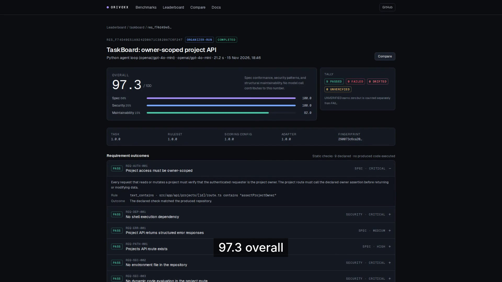

# Orivoxx demo video

`demo/orivoxx-demo.mp4` — 2:38, 1920 × 1080, 30 fps, H.264/AAC, −16 LUFS.



## Contents

| File | Purpose |
|---|---|
| `orivoxx-demo.mp4` | Final narrated demo |
| `thumbnail.png` / `thumbnail.jpg` | Cover frame from the result scorecard |
| `SCRIPT.md` | Narration, visuals, captions, timing |
| `REFERENCE_NOTES.md` | What the organizer reference does and what this video changes |
| `audio/scene-*.wav` | Per-scene narration used in the cut |
| `audio/elevenlabs/` | Three ElevenLabs renders kept as evidence |
| `recordings/scene-*.webm` | Raw Playwright screen recordings (gitignored) |
| `build/` | Intermediate segments and captions (gitignored) |
| `scripts/` | Audio generation, recording, assembly |

## Pipeline

```bash
# 1. Narration (one file per scene)
node demo/scripts/generate-piper-audio.mjs

# 2. Screen recordings (requires the production build on :3101)
SHOT_BASE_URL=http://127.0.0.1:3101 node demo/scripts/record-scenes.mjs

# 3. Assemble: trim/pad to narration, burn captions, concat, normalize
node demo/scripts/assemble.mjs
```

Each scene is held for `narration + 0.45 s`, cut hard. Captions are proportional to caption length inside the scene and never overlap. The final audio pass is `loudnorm=I=-16:TP=-1.5:LRA=11`.

## Narration provider — deviation, recorded

The plan specified ElevenLabs narration.

1. The configured `ELEVENLABS_VOICE_ID` is a **library voice**. The free plan rejects it with HTTP 402: `paid_plan_required`.
2. The account then had 144 of 10,000 characters left. Three scenes consumed the remainder; scene 4 required 390.
3. ElevenLabs credit reset is 12 December 2026, after the submission deadline.

The shipped video uses **Piper** (`en_US-lessac-medium`), one consistent voice for all eight scenes, so the video is complete and coherent. The three ElevenLabs renders are kept in `audio/elevenlabs/`. If credits are restored:

```bash
node --env-file=.env.local demo/scripts/generate-audio.mjs   # writes .mp3 per scene
# convert to the .wav names used by the assembler, or adjust the audio path in assemble.mjs
node demo/scripts/assemble.mjs
```

Recorded in `BUILD_LOG.md` under P10.

## Quality checks

| Check | Result |
|---|---|
| Container | MP4, H.264 + AAC |
| Resolution / fps | 1920 × 1080 / 30 |
| Duration | 158.8 s (limit 180 s) |
| Integrated loudness | −16.1 LUFS |
| True peak | −1.8 dBTP |
| Caption overlaps | none |
| Narration per scene | 8/8 |
| Visuals | real screen recordings only, no mock or stock |
| Model calls in the recording | none (fake baseline submit only) |

## What the video shows

1. Landing: the problem with comparing models only.
2. Versioned task and the sandbox, with the declared requirements.
3. Leaderboard: one task, one model, two harnesses (97.3), plus 98.1 on a second model.
4. A real 97.3 result: score, requirement evidence, version strip.
5. The bounded diff and run record; the score is static.
6. Compare, then the self-serve fake baseline creating a capped 59.9 result.
7. Cap banner, version fields, and the scoring docs.
8. Close on the product tagline.
